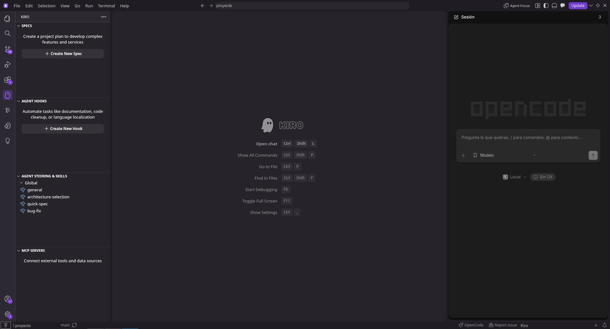

# OpenCode for Kiro

Integra la interfaz web de **OpenCode** dentro de **Kiro**, sin abrir una terminal
ni salir del editor. La UI vive en la barra lateral derecha y comparte ese espacio
con el chat de Kiro.

> Proyecto no oficial. No está afiliado a Kiro ni a OpenCode.



## Requisitos

| Componente | Necesitas | Cómo comprobarlo |
| --- | --- | --- |
| **Kiro** | Una versión actualizada (API de VS Code 1.94+) | Abre Kiro y comprueba que puedes instalar un VSIX. |
| **OpenCode** | **v2** instalado en la misma máquina | `opencode --version` debe empezar por `2.` |
| **Servicio** | El servicio local de OpenCode funcionando | `opencode service status` |
| **Sistema** | Linux, macOS o Windows | En Windows, OpenCode nativo (no WSL). |

- Instala OpenCode desde su documentación oficial: https://opencode.ai.
- El ejecutable debe estar en el `PATH` como `opencode` o en
  `~/.opencode/bin/opencode`. En Windows puede ser `opencode.exe` o
  `opencode.cmd`. Si está en otra ruta, configura `opencode.path`.
- Abre una carpeta en Kiro antes de usar la extensión.
- No necesitas Node, npm ni Bun para instalar el VSIX.

Para arrancar el servicio:

```sh
opencode service start
opencode service status
```

La extensión lee el estado de
`${XDG_STATE_HOME:-$HOME/.local/state}/opencode/service.json`. En Windows,
`$HOME` es `%USERPROFILE%`.

## Instalación

### Desde Open VSX (recomendado)

1. Abre la vista **Extensiones** en Kiro.
2. Busca **OpenCode for Kiro** o el ID `fghernandez.opencode-kiro`.
3. Pulsa **Install** y recarga Kiro.

También puedes instalarla por CLI:

```sh
kiro --install-extension fghernandez.opencode-kiro
```

Página de la extensión:
**https://open-vsx.org/extension/fghernandez/opencode-kiro**

> Si la búsqueda aún no la muestra, el índice de Open VSX puede tardar unos
> minutos u horas. La instalación por ID y el VSIX de GitHub funcionan igualmente.

### Desde un VSIX

1. Descarga `opencode-kiro.vsix` desde la última release:
   **https://github.com/McJigsaw12/opencode-kiro/releases/latest**
2. En Kiro, abre **Extensiones**, pulsa el menú `...` y elige
   **Install from VSIX...**.
3. Selecciona el archivo y recarga Kiro
   (`Ctrl+Shift+P` → **Developer: Reload Window**).

También puedes instalarlo por CLI:

```sh
kiro --install-extension opencode-kiro.vsix
```

## Cómo hacerla funcionar

1. Abre una carpeta en Kiro.
2. Pulsa el botón **OpenCode** de la barra de estado o usa
   `Ctrl+Alt+Shift+O` (`Cmd+Alt+Shift+O` en macOS).
3. La extensión arranca el servicio si no está en marcha, conecta la UI y enlaza
   el workspace abierto.
4. Si es la primera vez, ejecuta **OpenCode: Comprobar requisitos** y revisa
   **Ver → Resultados → OpenCode**.

## Uso

### Abrir y alternar

- El botón **OpenCode** de la barra de estado muestra OpenCode si está oculto y
  devuelve la barra al chat de Kiro si OpenCode está visible.
- `Ctrl+Alt+Shift+O` (`Cmd+Alt+Shift+O` en macOS) hace lo mismo.
- **OpenCode: Abrir en pestaña del editor** abre la UI como editor normal.
- **OpenCode: Alternar OpenCode / chat de Kiro** hace lo mismo desde la paleta.

### Enviar contexto desde Kiro

1. Abre un archivo y, si quieres, selecciona un fragmento.
2. Haz clic derecho y elige **OpenCode: Enviar archivo/selección como contexto**.
3. La extensión adjunta el archivo, añade la referencia
   `@archivo:línea-inicio-línea-fin` y el texto seleccionado, y abre el chat
   correspondiente.

El comando envía un mensaje real a la sesión. Si la sesión está trabajando, el
mensaje queda en cola. Si tienes varias conversaciones, usa **OpenCode: Enviar
archivo/selección a una conversación…** o pon `opencode.contextTarget` en `ask`.

### Copiar una referencia

**OpenCode: Copiar referencia del archivo/selección** copia `@ruta/archivo:N-M`
al portapapeles para pegarlo en el chat.

## Ajustes

| Ajuste | Por defecto | Descripción |
| --- | --- | --- |
| `opencode.path` | `opencode` | Ruta al ejecutable de OpenCode. |
| `opencode.autoStart` | `true` | Arranca el servicio si no está en marcha al abrir el panel. |
| `opencode.openInEditorColumn` | `left` | `left`, `right` o `active`. |
| `opencode.contextTarget` | `active` | `active` usa el chat abierto; `ask` pregunta cuando hay varias conversaciones. |

## Comandos

| Comando | Descripción |
| --- | --- |
| `OpenCode: Abrir en la barra derecha` | Muestra la UI en la barra lateral secundaria. |
| `OpenCode: Abrir en pestaña del editor` | Abre la UI como editor. |
| `OpenCode: Alternar OpenCode / chat de Kiro` | Alterna entre OpenCode y el chat de Kiro. |
| `OpenCode: Mostrar chat de Kiro` | Devuelve la barra derecha al chat de Kiro. |
| `OpenCode: Recargar` | Regenera la conexión y recarga la UI. |
| `OpenCode: Reiniciar servicio` | Reinicia el servicio de OpenCode. |
| `OpenCode: Comprobar requisitos` | Revisa sistema, servicio, versión y conexión. |
| `OpenCode: Copiar referencia del archivo/selección` | Copia `@archivo:línea`. |
| `OpenCode: Enviar archivo/selección como contexto` | Adjunta el archivo y la selección al chat abierto. |
| `OpenCode: Enviar archivo/selección a una conversación…` | Permite elegir el chat de destino. |

## Si algo falla

- **“No se pudo abrir OpenCode”**: revisa **Ver → Resultados → OpenCode**.
- **`opencode` no encontrado**: instala OpenCode v2 o configura `opencode.path`.
- **Windows no encuentra `opencode`**: usa OpenCode nativo y configura
  `opencode.path` con la ruta a `opencode.exe` o `opencode.cmd`.
- **“OpenCode X no es compatible”**: actualiza a OpenCode v2.
- **El servicio no arranca**: ejecuta `opencode service start` y comprueba
  `opencode service status`.
- **No aparece el botón OpenCode**: recarga Kiro después de instalar.
- **La UI queda en “Conectando…”**: ejecuta **OpenCode: Comprobar requisitos**
  y revisa la salida.
- **El comando de contexto abre otra conversación**: usa **OpenCode: Enviar
  archivo/selección a una conversación…** o pon `opencode.contextTarget` en `ask`.

## Licencia

[MIT](LICENSE)
